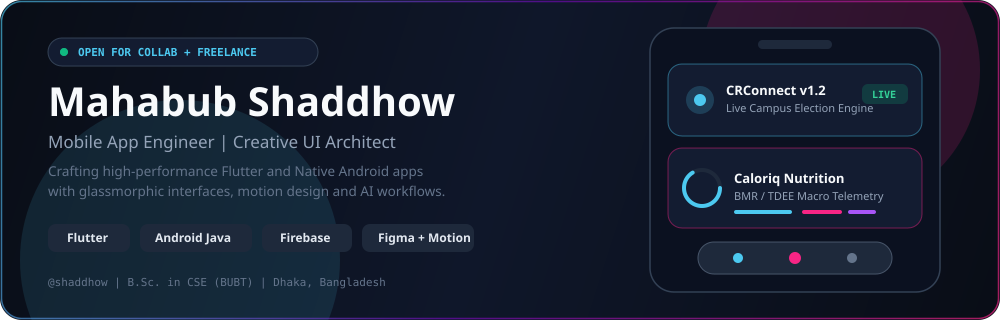

  

<table>
  <tr>
    <td width="50%" valign="top">
      <h3>CRConnect <code>v1.2</code></h3>
      
<strong>Campus Voting &amp; CR Management Platform</strong>

      <ul>
        <li>Anti-dual-voting tamper-resistant security layer</li>
        <li>ML Kit OCR student ID verification &amp; role portals</li>
        <li>Dark glassmorphic UI with real-time aggregation</li>
      </ul>
      

        
        
        
        
      

    </td>
    <td width="50%" valign="top">
      <h3>Caloriq <code>WIP</code></h3>
      
<strong>Smart Nutrition &amp; Macro Tracking Engine</strong>

      <ul>
        <li>Automated Mifflin-St Jeor BMR/TDEE deficit engine</li>
        <li>Custom-painted cubic bezier scooped floating nav dock</li>
        <li>Pure vector Q identity with adaptive Light/Dark mode</li>
      </ul>
      

        
        
        
      

    </td>
  </tr>
  <tr>
    <td width="50%" valign="top">
      <h3>OMNI_CALC</h3>
      
Production-grade scientific calculator featuring a custom mathematical expression parser and glassmorphic interface.

      

        
        
      

    </td>
    <td width="50%" valign="top">
      <h3>EduTrack</h3>
      
Desktop academic workflow suite with CGPA projections, ReportLab PDF analytics, and automated AI advising.

      

        
        
        
      

    </td>
  </tr>
</table>

 

<table>
  <tr>
    <td width="50%" align="center" valign="top">
      <h4>ENGINEERING &amp; SYSTEMS CORE</h4>
      

        
        
        
        
        
        
        
        
      

      ICPC Regionalist (Team BUBT_Brainstorm) · Codeforces: Lazy_Loaders
    </td>
    <td width="50%" align="center" valign="top">
      <h4>UI ARCHITECTURE &amp; MOTION CORE</h4>
      

        
        
        
        
        
      

      Champion · Tech Fusion Fest Ad Making Challenge
    </td>
  </tr>
</table>

 

  

<picture>
  <source media="(prefers-color-scheme: dark)" srcset="https://raw.githubusercontent.com/shaddhow/shaddhow/output/github-contribution-grid-snake-dark.svg" />
  <source media="(prefers-color-scheme: light)" srcset="https://raw.githubusercontent.com/shaddhow/shaddhow/output/github-contribution-grid-snake.svg" />
  
</picture>

  

  
  
  

