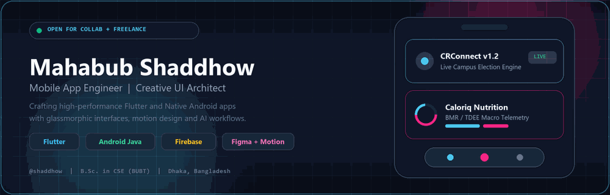
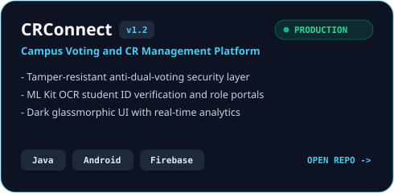
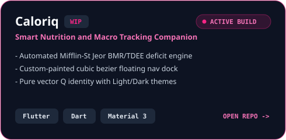

 

  

  
  

  
  

 

<table>
  <tr>
    <td width="50%" align="center" valign="top">
      <h4>ENGINEERING &amp; SYSTEMS CORE</h4>
      

        
        
        
        
        
        
        
        
      

      ICPC Regionalist (Team BUBT_Brainstorm) · Codeforces: Lazy_Loaders
    </td>
    <td width="50%" align="center" valign="top">
      <h4>UI ARCHITECTURE &amp; MOTION CORE</h4>
      

        
        
        
        
        
      

      Champion · Tech Fusion Fest Ad Making Challenge
    </td>
  </tr>
</table>

 

  

<picture>
  <source media="(prefers-color-scheme: dark)" srcset="https://raw.githubusercontent.com/shaddhow/shaddhow/output/github-contribution-grid-snake-dark.svg" />
  <source media="(prefers-color-scheme: light)" srcset="https://raw.githubusercontent.com/shaddhow/shaddhow/output/github-contribution-grid-snake.svg" />
  
</picture>

  

  
  
  

